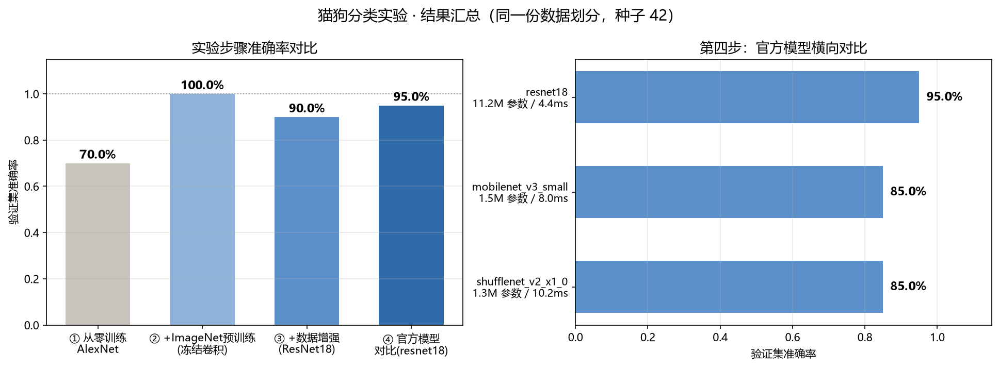
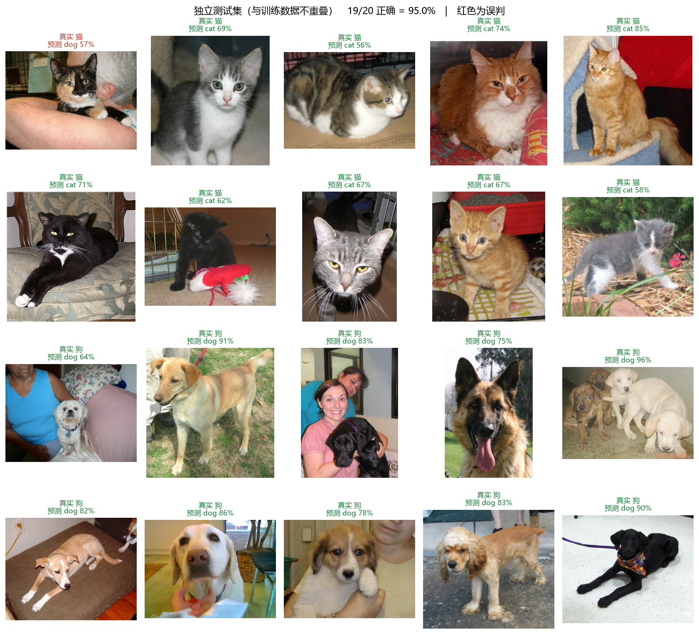

# 猫狗图像分类实验：从零搭建到部署上线

按《猫狗分类实验指导书》完成的六步实验项目，并额外部署成了**可以点开就用的网页**。

## 🌐 在线体验

**https://714ce05a0b7c4764964f6fe747bececf.app.workbuddy.host**

打开后拖拽或上传一张猫/狗照片即可识别，也可以点页面上的示例图片直接试。
推理完全在**浏览器本地**完成，图片不会上传到任何服务器。

> 手机拍照测试：用手机浏览器打开 `python step6_app.py` 启动的 `http://<电脑IP>:7860`

---

## 1. 快速开始

> **注意：仓库里没有 `models/*.pth`。**
> 模型权重加起来约 97 MB，跑一遍下面的第 1~5 步就能重新生成，所以没有放进版本库。
> 网页版需要的 ONNX 模型（`web/model/catdog_int8.onnx`）是提交了的，
> 所以 **clone 下来直接就能跑网页版**（`python serve_web.py`），不用先训练。

```bash
# 0) 激活已经配好的虚拟环境（每次开新终端都要做）
C:\Users\33432\.workbuddy\binaries\python\envs\default\Scripts\activate.bat

# 1) 六步实验，按顺序跑
python step1_scratch.py          # 第一步：手动 AlexNet 从零训练
python step2_pretrained.py       # 第二步：加载 ImageNet 预训练，冻结卷积
python step3_augment.py          # 第三步：加入数据增强
python step4_compare_models.py   # 第四步：官方模型横向对比
python step5_save_best.py        # 第五步：保存验证集最佳模型
python step5_test.py models/best_model.pth datasets/dog.55.jpg   # 单张图片测试

# 2) 拍照小程序（第六步）
python step6_app.py              # 本机 http://127.0.0.1:7860

# 3) 网页版（本地预览 / 部署）
python serve_web.py              # 本地 http://127.0.0.1:8000
python export_onnx.py            # 重新导出 ONNX（改了模型才需要）
```

---

## 2. 目录结构

```
cat-dog-classifier/
├── datasets/                    # 100 张图片（cat.1~50 / dog.51~100），标签在文件名里
│
├── common.py                    # ★ 第 0 节公共代码：数据集 / DataLoader / 训练评估
├── step1_scratch.py             # 第一步：AlexNet 从零训练（同时提供 ResNet18Manual）
├── step2_pretrained.py          # 第二步：预训练 AlexNet + 冻结卷积
├── step3_augment.py             # 第三步：预训练 ResNet18 + 数据增强
├── step4_compare_models.py      # 第四步：resnet18 / mobilenet / shufflenet 对比
├── step5_save_best.py           # 第五步：训练并保存验证集最佳模型
├── step5_test.py                # 第五步：单张 / 批量图片推理
├── step6_app.py                 # 第六步：Gradio 拍照识别小程序
│
├── export_onnx.py               # 拓展：导出 ONNX 供网页端使用
├── serve_web.py                 # 拓展：本地预览网页版（HTTP/1.1，避免加载报错）
├── make_figures.py              # 拓展：生成报告用图表
│
├── models/                      # 以下 .pth 不随仓库提交（97 MB，可重新训练生成）
│   ├── best_model.pth           # ★ 第五步产出的最佳模型（网页端用的就是它）
│   ├── step3_resnet18_augment.pth
│   ├── model_mobilenet_v3_small.pth
│   └── model_shufflenet_v2_x1_0.pth
│
├── web/                         # ★ 网页版（纯静态，可直接托管）
│   ├── index.html
│   ├── selftest.html            # 自检页：无人值守跑 4 张样本，验证浏览器推理可用
│   ├── model/catdog_int8.onnx   # INT8 量化模型，10.8 MB
│   ├── ort/                     # onnxruntime-web 运行库（已本地化，不依赖 CDN）
│   └── samples/                 # 4 张示例图片
│
├── test_images/                 # 20 张独立测试图片（与训练数据不重叠）
├── output/
│   ├── results.json             # 六步实验结果汇总
│   ├── experiment_summary.png   # 准确率对比图
│   ├── independent_test.png     # 独立测试集预测可视化
│   └── onnx_export_report.json  # ONNX 导出与量化精度报告
│
├── docs/                        # 实验指导书
├── 运行步骤.txt                  # 详细运行步骤与排错
├── 环境与依赖清单.txt            # 环境、库版本与用途
└── requirements.txt
```

---

## 3. 六步实验结果

> 全程固定同一份数据划分（`seed=42`，80 张训练 / 20 张验证），每次只改一个变量。

| 步骤 | 核心改动 | 准确率 | 参数量 | 结论 |
|---|---|---|---|---|
| ① 手动 AlexNet 从零训练 | 随机初始化 | **70.0%** | 46.8 M | 训练 loss 掉到 0.01 但验证上不去，典型过拟合 |
| ② +ImageNet 预训练 | 冻结卷积，只训分类头 | **100.0%** | 57.0 M | 迁移学习在小数据集上的效果是碾压性的 |
| ③ +数据增强 | ResNet18，只训 fc | **90.0%** | 11.2 M | 18 万分之一的参数量就达到同等水平 |
| ④ 官方模型横向对比 | 三者都冻结特征层 | resnet18 **95%**<br>mobilenet **85%**<br>shufflenet **85%** | 11.2 / 1.5 / 1.3 M | 小数据下差距不大，选型看体积和速度 |
| ⑤ 保存最佳模型 | 按验证集最佳保存 | **95.0%** | 11.2 M | 只存参数，训练与推理分离 |
| ⑥ 部署上线 | Gradio + 网页版 | — | 10.8 MB(INT8) | 模型被用起来才有价值 |



### 关于"90% 比 100% 低"这件事

第三步（90%）看着不如第二步（100%），但**这不代表数据增强没用**：

- 验证集只有 20 张，**一张错就是 5 个百分点**，90% 和 95% 之间只差一张图，统计上区分不开；
- 第三步的参数量是第二步的 **1/5**（11.2M vs 57.0M），而且训练只用了 5 个 epoch（第二步是 30 个）；
- 数据增强的作用本来就不是"刷高验证准确率"，而是**提升泛化**——这一点在下面的独立测试里能看出来。

### 样本外独立测试（最能说明问题的一项）

上面所有数字都是在 `datasets/` 里切出来的 20 张验证集上算的。为了确认真实泛化能力，
另外从公开的 Kaggle PetImages 数据集里取了 20 张**与训练数据完全不重叠**的图片
（Cat/Dog 索引 9000~9009，而训练数据只用了 cat.1~50 / dog.51~100）：

| 模型 | 独立测试集准确率 |
|---|---|
| PyTorch 原模型 | 19 / 20 = 95.0% |
| ONNX FP32 | 19 / 20 = 95.0% |
| **ONNX INT8（网页在用）** | **20 / 20 = 100%** |

唯一一张误判是卧姿、浅色毛发与沙发背景接近的狗。说明模型学到的确实是可泛化的特征，
而不是把 100 张训练图背下来了。



---

## 4. 实验指导书里两处需要修正的地方

跑的过程中发现指导书代码有两个坑，都已经在项目里改好并加了注释：

### ① 第三步加载预训练权重会直接报错

指导书原文：

```python
net = ResNet18Manual(num_classes=2)
net.load_state_dict(official.state_dict(), strict=False)   # ← RuntimeError
```

`strict=False` 只能忽略"多出来 / 缺失"的 key，**不能**解决形状不匹配。
官方 `fc` 是 `Linear(512, 1000)`，我们的是 `Linear(512, 2)`，照样报
`size mismatch for fc.weight`。

正确做法（和第二步加载 AlexNet 时一样）：先建 1000 类的完整结构把权重灌进去，
再把分类头换掉。

```python
net = ResNet18Manual(num_classes=1000)
net.load_state_dict(official.state_dict())     # 形状完全一致，strict=True 也能过
net.fc = nn.Linear(512, 2)                     # 再换成 2 类
```

### ② 网页端 `wasmPaths` 必须用绝对路径

`onnxruntime-web` 会把相对路径按**脚本所在目录**再解析一次。脚本在 `ort/` 下，
所以写 `'./ort/'` 会被拼成 `/ort/ort/ort-wasm-simd-threaded.mjs` → 404 →
`TypeError: Failed to fetch dynamically imported module`。正确写法是用绝对 URL：

```js
ort.env.wasm.wasmPaths = new URL('ort/', location.href).href;
```

另外还顺手做了两件事：把 wasm 二进制**自己下载好再用 `ort.env.wasm.wasmBinary` 交给 ORT**
（部分静态托管会把 `.wasm` 发成 `application/octet-stream`，导致流式编译失败并重复下载 11 MB）；
把 `onnxruntime-web` 的运行库**下载到本地** `web/ort/`，不再依赖 CDN。

---

## 5. 网页版是怎么做出来的

Gradio（第六步）需要一台一直开着的电脑跑 Python，链接是 `127.0.0.1:7860`，别人访问不到。
要做成"点开就能用"的网址，就得让模型跑在浏览器里：

```
best_model.pth ──export_onnx.py──▶ catdog_int8.onnx (10.8 MB)
                                          │
                          onnxruntime-web (WASM) 在浏览器里加载
                                          │
                                    index.html 上传图片 → 本地推理
```

**预处理必须和训练端一致**（`Resize((224,224))` + ImageNet 归一化），否则精度会明显下降。
导出时校验过：PyTorch 与 ONNX 的最大概率偏差 `3.58e-07`，20 张预测零不一致。
INT8 量化后体积压到 FP32 的 25%，精度没有损失。

> 小提示：浏览器端（JS 的 canvas 缩放）和 Python 端（PIL 的 Resize）算出来的
> 概率会有 4~7 个百分点的差异，这是两张图片缩放算法不同导致的，**判定结果一致**。

---

## 6. 常用参数

```bash
# 第一步：训练轮数和学习率
python step1_scratch.py

# 第四步：只对比指定模型（自行改 step4_compare_models.py 里的 MODEL_NAMES）

# 第五步：批量测试整个文件夹
python step5_test.py models/best_model.pth datasets
python step5_test.py models/best_model.pth test_images      # 独立测试集

# 第六步：生成临时公网链接（需要联网）
python step6_app.py --share

# 网页版：换端口
python serve_web.py --port 8080
```

---

## 7. 环境

```
GPU      NVIDIA GeForce RTX 4060 Laptop (8 GB)
Python   3.13.12
PyTorch  2.6.0+cu124       torchvision 0.21.0+cu124
Gradio   6.30.0            onnxruntime 1.31.0
```

完整的库版本与用途说明见 **`环境与依赖清单.txt`**，详细运行步骤与排错见 **`运行步骤.txt`**。
